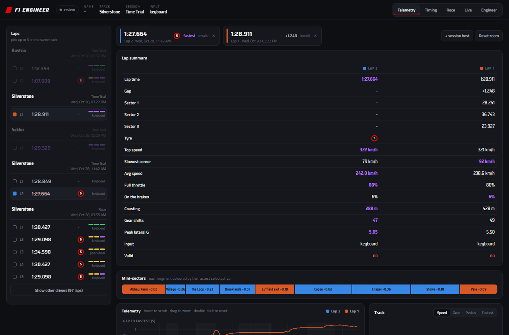
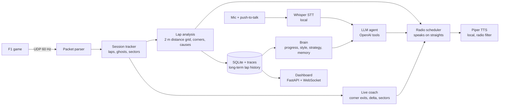

# F1 Engineer

**A teaching race engineer for the F1 video games.** It listens to your game's live telemetry, talks to you on the
radio like a real pit wall, tells you exactly where you lost time and why, coaches you lap after lap, and you can
just *talk* to it: "Where am I losing time?", "Am I improving?", "What's my driving style?", "Will a one-stop on
lap 12 work?".

Works with **F1 2020 through F1 25** (including F1 25's 2026 season update) on Windows, with Linux and macOS support.
Telemetry analysis, speech recognition and the voice run locally on your PC; the conversational brain uses OpenAI
(optional: without a key a built-in offline brain still runs the radio).



---

## What it does

**On the radio, while you drive**
- **Never talks mid-corner.** Messages wait for a straight long enough to say them (or the safety car, the garage, a pause).
- **Calls your mistakes as they happen.** "Lock-up into Village. Ease the brake pressure as you turn." "Stowe, three tenths lost: apex speed 16 km/h lower." "Lap's invalid, track limits." "That lap's gone, two seconds down. Use the rest to work on Luffield."
- **Sector deltas and lap context.** "Sector two, four tenths up." "You're three tenths up, bring it home." Out laps, in laps.
- **Debrief after every lap.** Lap time vs your best (or the Time Trial ghost), the biggest losses with the cause (braked 12 m early, apex speed down, late on the throttle, coasting, wheelspin...), what you did well, and "Next lap, focus on X: do Y".
- **Even on lap one.** No reference yet? It reviews the lap on its own (lock-ups, running wide, wheelspin, coasting).
- **Races, like a real pit wall:** a radio check with the actual conditions, then he calls it himself: "Safety car. Box, box, cheap stop" (or "stay out" when it isn't worth it), "Tyres are done, box this lap", "Box next lap for mediums" from a strategy simulation rerun every lap, "Rears are hot, easy on the exits", cold tyres, hot brakes, fuel, rain, DRS fights, damage and penalties. A lap-by-lap race log is kept.
- **Thinks for himself:** at lap ends and on events the AI investigates the race or your lap with its tools and decides whether a call is worth making (or stays silent). Your own questions stay a normal conversation.
- **Sounds like an engineer, not a gadget:** short calls, number first, brisk voice (speed adjustable), dry humour only now and then (sass 0-3).

**A coach you can talk to** (push-to-talk in the car, or chat on the dashboard)
- Ask anything: tyre temps, who you're racing, why you're slow in a corner, what to change in the setup.
- **Long-term memory:** it tracks every lap you drive (90 days), so it can answer "Am I improving?" with numbers, describe your driving style (brake ramp, trail braking, coasting, throttle pick-up, vs the reference), and follow up on goals you tell it ("remember: my goal is a 1:27 at Silverstone").
- **Strategy maths:** "I'm thinking softs, pit lap 4 for hards in a 10-lap race?" is simulated against the best 0/1/2-stop plans (compound pace, wear, cliff, pit loss, two-compound rule), and it will tell you if your plan is worse and by how much.
- Short and sharp at speed; a proper conversation when you're parked, paused or on the dashboard. It writes you a garage debrief after each lap.
- **Instant answers for plain facts, AI for thinking:** tyre temps, wear, gaps (and whether they're closing), position, laps left, fuel, battery, brakes, damage, weather and the pit plan are read straight off the telemetry in under a millisecond, with an engineer's judgement ("all in the window", "he's closing, cover the inside"). The AI is used only for questions that need reasoning (why, should I, setup, strategy, improvement) and for its own calls.
- **Notices patterns like an engineer:** a corner that costs time three laps running gets one call with the usual cause (and praise when it's fixed); a one-off doesn't. Pace dropping on worn tyres is blamed on the tyres, not you; pace dropping on good tyres is on you; in races the lighter fuel load is taken into account.
- Ask several things in a row: answers are worked out in parallel and come back one by one in the order you asked; a double press is merged, nothing goes silent (instant "Checking.", hard timeouts).

**Dashboard** (`http://127.0.0.1:8020`, also works without the game running)
- **Live** (opens when the game is running): a timing tower for the whole field (interval to the car ahead in a race, gap to the fastest lap in practice/qualifying, tyre and age, pit / out / finished), your position and live delta, this lap's sectors against your best, the cars ahead and behind with the gap, DRS range and whether it's closing, a live track map with every car, car status (speed, gear, pedals, tyre temperatures and wear, fuel at the flag, ERS, aids), the radio feed newest-first with an ask box, and the last lap corner by corner. Safety car / VSC shows in the header. Setup suggestions and practice plans appear outside races.
- **Timing:** the live tower while you drive (gap, interval, last and best lap, current sectors, lap, tyre, status, penalties), and the lap board: every stored lap, filtered by circuit, mode (race / qualifying / practice / time trial), drivers (you, everyone else, everyone), best lap per driver or every lap, valid only. Your laps are marked YOU whichever car you drove.
- **Lap analysis:** overlay up to three laps of the same track (other tracks are locked out; laps from different sessions on the same track are fine). Lap summary table (time, gap, sectors, tyre, top/min/avg speed, full throttle, braking, coasting, shifts, peak G), mini-sectors coloured by the fastest lap, synced traces (gap to fastest, speed with corner names, throttle, brake, gear, RPM, steering, lateral and longitudinal G) with drag-zoom, a correctly oriented track map (speed / gear / pedals / who's fastest where) with scrub dots, corner table, G-G diagram and the engineer's notes.
- **Sessions:** pick a session and see everyone's laps: by driver (each driver's laps in a row, best, gap, average), by lap (all drivers on lap x, ranked) or by time (laps finished in 2-15 minute windows, with a from-to range). Below: your own lap table with purple/green/yellow sectors and the ideal lap, lap-time progression, mini-sectors, and for races position, gaps, lap times, tyre stints and wear. Click any lap to analyse it.
- **Engineer:** chat, and everything the engineer remembers. Colours are colour-blind validated; every tyre badge carries its letter too.

**It knows how you drive:** detects keyboard vs controller from the telemetry, reads your TC/ABS assists, and adapts the advice.

---

## Requirements

| | |
|---|---|
| OS | **Windows 10 / 11** (everything). **Linux** (incl. Steam Proton) and **macOS** also work, see [Compatibility](#compatibility-and-adaptation). |
| Game | **F1 2020, F1 2021, F1 22, F1 23, F1 24, F1 25** (and its 2026 season update), PC or console. |
| Hardware | Microphone and speakers/headset. ~1.5 GB free disk (+2 GB with NVIDIA GPU libraries). An NVIDIA GPU is optional (faster speech recognition when it's free; the CPU works fine). |
| Optional | An **OpenAI API key** for the conversational engineer ([how to get one](#openai-api-key)). |

You don't need to install Python yourself: the setup uses [uv](https://docs.astral.sh/uv/), which brings its own Python 3.12.

---

## Install

### Option A: one command (recommended)

```powershell
git clone https://github.com/<you>/F1Engineer.git
cd F1Engineer
powershell -ExecutionPolicy Bypass -File setup.ps1
```

`setup.ps1` installs uv if it's missing, installs the dependencies (adding the CUDA libraries automatically if it finds
an NVIDIA GPU), then starts the setup wizard.

### Option B: step by step

```powershell
# 1. install uv (skip if you have it)
powershell -ExecutionPolicy Bypass -c "irm https://astral.sh/uv/install.ps1 | iex"

# 2. install the dependencies (creates .venv with Python 3.12)
uv sync                  # CPU only
uv sync --extra gpu      # or: with NVIDIA GPU speech recognition

# 3. run the setup wizard
uv run f1engineer setup
```

> **GPU users:** always use `uv sync --extra gpu`. A plain `uv sync` removes the GPU libraries again (it still works, on the CPU).

### The setup wizard (`uv run f1engineer setup`)

It asks for everything it needs and explains each step. You can re-run it any time to change answers.

1. **Game telemetry:** finds your F1 game config and offers to switch UDP telemetry on (it makes a backup first, and only edits it while the game is closed).
2. **OpenAI API key** (optional): explains how to get one, checks it, and saves it to `.env`. You can choose the model.
3. **Your engineer:** sass level, voice (British/American, male/female), push-to-talk key (default **Shift**) and controller button (default **right-stick click**), GPU use.
4. **Downloads the local models** (Piper voice + Whisper speech recognition, ~300 MB).
5. **Audio check:** lists your microphones so you can pick the real one, plays a radio check, records 3 seconds and shows what it heard.
6. **Autostart** (optional): a tiny background watcher that starts the engineer when the game starts and stops it when the game closes.

Everything is stored in `.env` (settings and key) and `data/` (laps), both gitignored.

---

## Connect the game

The wizard does this for you on PC. To do it by hand, in the game go to
**Game Options > Settings > Telemetry Settings** and set:

| Setting | Value |
|---|---|
| UDP Telemetry | On |
| UDP Broadcast Mode | Off |
| UDP IP Address | `127.0.0.1` |
| UDP Port | `20777` |
| UDP Send Rate | 60Hz |
| UDP Format | your game's own year (any of 2020-2025 works) |

Or from the command line (with the game closed): `uv run f1engineer udp enable`. Undo with `uv run f1engineer udp restore`.

**Playing on a console (PS/Xbox) on the same network:** set the console's UDP IP to your PC's local IP address, put
`F1E_UDP_HOST=0.0.0.0` in `.env`, and allow Python through the Windows firewall for UDP port 20777.

---

## OpenAI API key

The conversational engineer (questions, progress, style, strategy, garage debriefs) uses OpenAI. Radio calls, lap
analysis and live coaching work without it.

1. Go to <https://platform.openai.com/api-keys> and sign in or create an account.
2. Click **Create new secret key**, name it, copy it (it starts with `sk-`).
3. Add a few dollars of credit under **Settings > Billing**. With the default `gpt-5.4-mini`, a session of chatting costs cents.
4. Paste it in `uv run f1engineer setup` (or put `OPENAI_API_KEY=sk-...` in `.env`).

**What is sent to OpenAI:** your questions as text and the lap numbers and summaries the engineer looks up to answer
them. Never audio, never files. Speech recognition and the voice run on your PC.

**Choosing a model:** `OPENAI_MODEL` in `.env` (default `gpt-5.4-mini`). To compare models on real questions about
your own laps: `uv run python tools/pick_model.py gpt-5.4-mini gpt-6-luna` (add `--write` to save the fastest).

---

## Run it

| How | Command |
|---|---|
| **Automatic** (recommended) | `uv run f1engineer autostart on`, then just launch the game. The engineer starts with it and stops 45 s after it closes. |
| Manual | `uv run f1engineer run`, then start the game. Opens the dashboard in your browser. |
| Review laps / chat without the game | `uv run f1engineer dashboard` |

**First session:** drive a lap. The engineer debriefs it and it becomes your reference (in Time Trial, the game's
ghost is used as soon as it's available). From the next lap on you get corner-by-corner comparisons. Your personal best
per track is remembered between sessions.

### Talking to the engineer

Two ways, use either:

- **Hands-free: say "Hey Bono"** (the engineer's name, after Hamilton's engineer) followed by your question:
  "Hey Bono, what are my tyre temps?". Or just "Bono", wait for "Go ahead", then ask. Run `uv run f1engineer wake`
  once and say the name four times so it learns your voice and your room (setup offers this too).
- **Push-to-talk:** hold **Shift** (keyboard) or **right-stick click** (controller), speak, release. You hear a beep
  when the radio opens; keys are detected even while the game has focus.

**Radio etiquette.** You always have priority: press Shift or say "Bono" and he stops mid-sentence, listens, then picks
up where he left off ("As I was saying...") - nothing he meant to tell you is thrown away. If a call is due while he's
still working on your question, he says "Still on what you asked. Meanwhile..." and answers later with context ("On
the setup: ..."). After "Go ahead" you have 2.5 s to start talking (otherwise "Didn't hear anything"), and he waits
for 1.4 s of quiet before deciding you've finished. With Shift there's no guessing: release = done.
Voice commands: "say again", "stop", "quiet" (urgent calls only for five minutes), "radio on".

**Practice plans.** "Give me a practice plan" - he builds 2-5 targets aimed at the *causes* of your biggest losses and
measures every lap against them. Targets per corner: time lost (total, entry or exit), apex and exit speed, braking
point, full-throttle point, coasting, gear at the apex, no lock-up / wheelspin / running wide; per lap: lap time, gap
to your reference, a sector time, a clean or valid lap, max mistakes, total coasting, consistency over several laps.
After each lap he closes the loop: a miss comes with the reason and the fix ("Village: 110, target 115. You braked
12 m earlier: brake at a later marker."), progress is noted ("Closer: 110 to 111"), two clear misses bring a halfway
target ("Let's get 113 first"), and a hit raises the bar once before moving on. Say "plan status", "skip step" or
"stop the plan". The Live tab shows the plan.

**Explain that.** After any call, say "explain that" and he expands it: what it means, why, and exactly how.

**Head-to-head.** Set a new session best and he compares it with your best from another session on the same track:
"That's three tenths quicker than Tuesday, most of it at Stowe" or "Still four tenths off Tuesday: Luffield, braked
26 m later and overshot". Ask "how do I compare to last time?" for the full breakdown (sectors, corners, style), or use
"+ best from another session" on the dashboard.

**Setup.** He reads the car's current setup with each slider's range and what it does, suggests concrete moves
("front anti-roll bar 7 -> 6"), never past a slider limit, uses tyre temperatures, and remembers which setup every lap
was driven on - so he can tell you whether the last change actually worked.

**Memory.** Tell him how you like to drive or be coached ("coasting is fine for me on keyboard", "don't nag me about
kerbs") and he keeps it as a preference per topic; saying something new on the same topic replaces it (the old one is
kept as history). Preferences are soft: he follows them, but if a specific corner clearly costs time he'll say so
once ("Your call on coasting, but for the record: Village, three tenths"). Goals and facts are remembered as notes.
See and delete everything on the dashboard's Engineer tab.

He confirms straight away what he's doing ("Looking into setup changes.", "Let me gather your driving style.",
"Running the strategy numbers."), answers plain facts instantly, and says "Say again?" if he heard the button but no
words. Things to try:

- "Where am I losing time?" / "What happened at the Loop?" / "Why did I lock up?"
- "What are my tyre temps?" / "Who am I racing?" / "What's the gap behind?"
- "Am I improving?" / "What's my driving style?" / "What should I practise next session?"
- "Twenty lap race, start on softs, pit lap 9 for mediums: will that work?"
- "Remember that my goal is a 1:27 at Silverstone."
- "Should I change my brake bias?" / "Explain trail braking."
- In a race: "Where am I losing time to Verstappen?" / "How do I compare to the leader?" / "Race update"

**Racing other drivers.** Every car's speed, braking and throttle are recorded, so he compares you with any driver
corner by corner, from the first few hundred metres of lap 1 ("0.6 down to Verstappen this lap so far. Luffield, 0.12:
he carries 9 km/h more through the apex"). No name means the car ahead. Every sector he
watches the real gap to the car ahead (within 6 s) and behind (within 3 s): when it moves 0.15 s in a sector, or the
same way three sectors running, he calls it with where it happened and what to do ("Ricciardo is closing, 0.6 that
sector, 0.8 behind. He's quicker at Village: brakes 9 m later. He's in DRS, defend." / "Gaining on Verstappen, 0.5 over
three sectors. DRS in 2 laps at this rate."). The data spots it; the AI phrases it and adds the action when it answers
within 5 s, otherwise the data line goes out. The question answers are data answers: instant, and they still work if
the internet or the AI drops out.

---

## Commands

| Command | What it does |
|---|---|
| `uv run f1engineer setup` | Setup wizard (safe to re-run) |
| `uv run f1engineer wake [--name Bono]` | Teach him your voice saying his name (hands-free radio) |
| `uv run f1engineer doctor` | Health check: dependencies, models, key, microphone, GPU, game config, ports, autostart |
| `uv run f1engineer run` | Start the engineer now (telemetry + radio + dashboard) |
| `uv run f1engineer dashboard` | Review stored laps and chat, no game needed (hands over to the live engineer if the game starts) |
| `uv run f1engineer autostart on\|off` | Start/stop the background watcher at login (Windows, Linux, macOS) |
| `uv run f1engineer watch [--detach]` | Run the watcher yourself |
| `uv run f1engineer udp [show\|enable\|restore]` | Inspect, enable or restore the game's telemetry config |
| `uv run f1engineer record` | Record raw telemetry to `data/captures/*.f1cap` |
| `uv run f1engineer import [files]` | Analyse recordings into the lap database (the dashboard does this automatically for the newest 2) |
| `uv run f1engineer replay FILE [--speed N]` | Replay a recording over UDP into a running engineer |

---

## Configuration (`.env`)

The wizard writes `.env`; every setting has a safe default (see [.env.example](.env.example)).

| Setting | Default | Meaning |
|---|---|---|
| `OPENAI_API_KEY` | (empty) | Enables the conversational engineer |
| `OPENAI_MODEL` | `gpt-5.4-mini` | Chat model |
| `F1E_SASS` | `2` | 0 professional ... 3 roasts you |
| `F1E_TTS_VOICE` | `en_GB-alan-medium` | Piper voice |
| `F1E_TTS_SPEED` | `1.4` | Speaking rate (1.0 = Piper default) |
| `F1E_RADIO_FX` | `light` | Radio effect: `light` (crisp), `full` (narrow, crunchy pit radio), `off` |
| `F1E_WAKE` / `F1E_ENGINEER_NAME` | `on` / `Bono` | Hands-free wake word, and your engineer's name (pick any: it changes the wake word too) |
| `F1E_PTT_KEY` / `F1E_PTT_BUTTON` | `shift` / `RS` | Push-to-talk key / controller button |
| `F1E_MIC` | (Windows default) | Part of your microphone's name, e.g. `Kraken` (a headset mic is far more accurate than a laptop mic next to the game's speakers) |
| `F1E_SPEAKER` | (Windows default) | Part of the headset/speaker name for the engineer's voice, e.g. `Kraken` (use the device your game sound plays on) |
| `F1E_STT` | `local` | Speech recognition: `local` (Whisper small.en on a free GPU, base.en on CPU) or `openai` (cloud, best in very noisy rooms, slower) |
| `F1E_GPU` | `auto` | `auto` = use the GPU only while it has free memory; `off` = CPU |
| `F1E_UDP_HOST` / `F1E_UDP_PORT` | `127.0.0.1` / `20777` | Telemetry listener (`0.0.0.0` for a console on your LAN) |
| `F1E_WEB_PORT` | `8020` | Dashboard port |
| `F1E_KEEP_SESSIONS` | `5` | Sessions with full telemetry traces |
| `F1E_HISTORY_DAYS` | `90` | Lap history used for progress/style |
| `F1E_MAX_DATA_GB` | `1.0` | Hard cap for `data/` |
| `F1E_MIN_FREE_GB` | `5.5` | Stop writing when the disk gets this full |

---

## Compatibility and adaptation

Nothing to configure: the engineer works out what it's talking to and adapts.

- **Game.** Every packet says which format it uses; the matching reader is picked automatically (F1 2020 natively,
  2021-2025 converted into one internal shape). The game is named on the dashboard and the engineer uses that game's
  knowledge (car generation, handling, setup ranges, 2026 rules). Each layout is checked against the official packet
  sizes; if a game update ever changes one, it's logged once and skipped instead of misread.
  F1 2020 is tested with real sessions; newer games are built from the official specs and verified by converting a
  real session into each format (`tools/encode_format.py`). Real-game reports welcome.
- **OS.** Windows: everything. Linux: engine, voice, dashboard, autostart (XDG) and game detection under Steam
  Proton; keyboard push-to-talk needs X11 (on Wayland use a controller button). macOS: no native F1 game, so play
  on a console or another PC and point its UDP at the Mac; keyboard push-to-talk needs Accessibility permission.
  Controller push-to-talk always works because the game reports its buttons in the telemetry.
- **Your driving.** Keyboard or controller/wheel is detected from the inputs; TC and ABS from the car. With ABS on
  there's no lock-up coaching, with full TC no wheelspin nagging, and keyboard drivers get keyboard-specific instructions.
- **Your level.** From your last laps (consistency, mistakes, gap to your reference) you're rated learning, developing
  or quick. Learners get one fix at a time and more encouragement; quick drivers get terse hundredths-level calls
  and sector deltas. It re-evaluates every lap, so it moves with you.

## Storage, privacy and guardrails

- **Everything stays in the project folder:** `data/` (laps, history, recordings), `models/` (speech models), `logs/`, `.env`. All gitignored.
- **Storage limits:** full telemetry for the last 5 sessions; 90 days of compact lap history (~2 KB per lap); newest 2 raw recordings (max 30 days); 30 days of radio log; a personal-best lap per track; `data/` is capped at 1 GB (recordings are dropped first). Writes stop if free disk falls below 5.5 GB.
- **Light on your PC:** runs at below-normal priority (the game always wins), about 1% of a CPU core for telemetry, about 400 MB of RAM, and restarts itself if it ever exceeds a memory cap. It uses the GPU only when VRAM is free and moves to the CPU when another program needs it.
- **Network:** the dashboard and telemetry listener bind to `127.0.0.1` only. The only outbound connection is to OpenAI, and only if you add a key.
- **Your game:** the config is only edited with your consent, while the game is closed, after a backup (`udp restore` puts it back).

---

## Troubleshooting

| Problem | Fix |
|---|---|
| No radio at all | `uv run f1engineer doctor`. Check UDP telemetry is on in the game (IP 127.0.0.1, port 20777) and nothing else is using port 20777. |
| It mishears me | Use a headset mic (`F1E_MIC`), re-run `uv run f1engineer wake`, or try `F1E_STT=openai`. Check `logs/engine.log` for what was heard. |
| It doesn't hear me | Try "Hey Bono" (hands-free) first. You should hear a beep when you press push-to-talk. `doctor` shows which microphone is used; virtual mics (phone-webcam apps, Stereo Mix) record silence. Pick your real mic in `setup` or set `F1E_MIC`. Check `logs/engine.log` for "PTT released ... level ... dBFS". |
| Shift does something in the game | Choose another key in `setup` (or `F1E_PTT_KEY`), or use the controller button. |
| Answers are generic / "offline" | No or invalid OpenAI key or no credit: `doctor`, then re-run `setup`. |
| "UDP port 20777 is busy" | Another telemetry app (or a second engineer) is running. Close it. |
| Newer F1 game, nothing happens | `doctor` and `logs/engine.log`: a line `[telemetry] F1 xx: packet N is X bytes, expected Y` means a game update changed a layout; please open an issue with that line. |
| GPU libraries vanished | You ran plain `uv sync`; run `uv sync --extra gpu`. |
| Logs | `logs/engine.log`, `logs/watcher.log` (rotating, small) |

---

## How it works



- Laps are put on a 2 m distance grid and compared with the reference corner by corner (corners found from speed minima, named where a track table exists). Causes come from brake points, apex speed, throttle-on point, coasting, wheel slip (lock-ups / wheelspin) and surface type (off track).
- In Time Trial the ghost car sends no lap data, so its lap is rebuilt from its position on the track map.
- Speech runs in a separate process (Piper TTS, faster-whisper STT) so it never stalls telemetry.
- The LLM only ever sees numbers from tools (lap reports, progress, style, strategy simulation, live car state) and is told never to invent any.

### Project layout

```
f1engineer/
  telemetry/     packet formats (2020 native; 2021-2025 adapters), capture file format
  state/         session tracker (laps, sectors, ghosts, flashbacks)
  analysis/      lap maths, coaching reports, setup advisor, strategy, track map, ghost tracking
  coaching.py    live in-lap calls          radio.py   message templates + scheduler
  brain.py       progress, driving style, strategy simulator, driver memory
  llm/           agent (OpenAI tool calling + offline brain), knowledge base
  speech.py      TTS/STT worker, push-to-talk (keyboard, XInput, in-game buttons)
  engine.py      wires it all together      web/       dashboard
  storage.py     SQLite + traces + retention  guard.py   resource guardrails
  watcher.py     start with the game        onboarding.py  setup wizard + doctor
  adapt.py       skill tier, assists, input -> coaching style    platform_info.py  OS capabilities
tools/           record, replay, convert to other game formats, latency benchmark, model picker
sim/             synthetic 20-car race generator for testing without the game
tests/
```

---

## Development

```powershell
uv sync --extra gpu            # dev tools (pytest, ruff) are included by default
uv run pytest                  # tests never call a paid API
uv run ruff check .
uv run python tools/replay.py data/captures/<file>.f1cap --ask "Where am I losing time?"   # in-process replay
uv run python tools/bench_latency.py                                                       # ingest / analysis / voice latency
```

Record your own sessions with `uv run f1engineer record` while driving; tests that need a real recording are skipped
when none is present.

**Ideas / not done yet:** confirmation of the F1 2021-25 layouts on real games; corner name tables for more tracks
(only Silverstone has names, others show "Turn N"); tyre-temperature based setup advice.

---

## Credits and disclaimer

Uses [faster-whisper](https://github.com/SYSTRAN/faster-whisper), [Piper](https://github.com/rhasspy/piper),
[uPlot](https://github.com/leeoniya/uPlot) (MIT, vendored), FastAPI, NumPy and the OpenAI API.

This is an unofficial fan project. It is not affiliated with, endorsed by or connected to Formula 1, the FIA,
Codemasters or Electronic Arts. F1 and related marks are trademarks of their owners.
